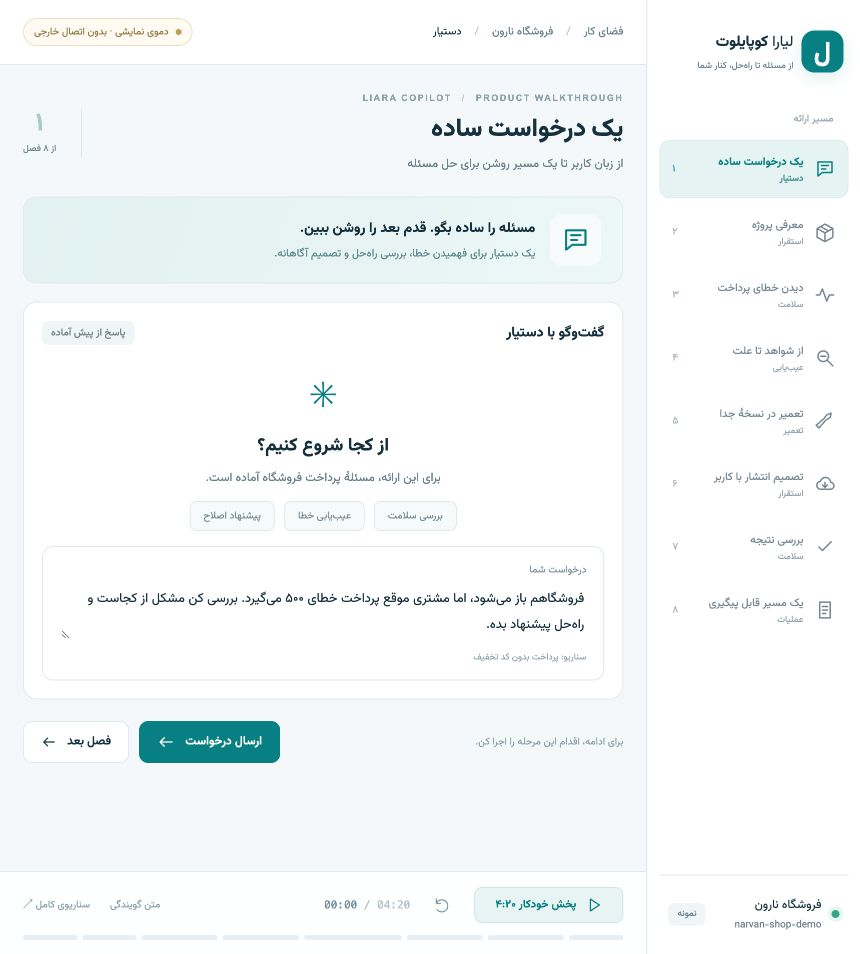

# لیارا کوپایلوت | Liara Copilot

دستیار فارسی برای نمایش مسیر بررسی خطای وب‌سایت، تشخیص علت، تعمیر در نسخهٔ جدا و بازبینی نتیجه. رابط راست‌به‌چپ، فونت محلی **وزیرمتن** و یک دموی آمادهٔ ارائه با زمان **۴ دقیقه و ۲۰ ثانیه** دارد.



این مخزن، سورس کامل رابط، سرور محلی، سناریوی ارائه، پروژه‌های آزمایشی و تست‌ها را در بر می‌گیرد.

## اجرای سریع دموی ارائه

پیش‌نیاز ساخت از سورس: **Node.js 26 یا بالاتر**، npm و Git.

```sh
git clone https://github.com/setoodehsamin9-hash/liara-copilot.git
cd liara-copilot
npm ci
npm run build
npm run demo:open
```

دمو در [127.0.0.1:4322](http://127.0.0.1:4322/?demo=recording) باز می‌شود. «پخش خودکار ۴:۲۰» را بزنید؛ همهٔ فصل‌ها و اقدام‌های سناریو به ترتیب نمایش داده می‌شوند. توقف، ادامه، انتخاب فصل، اجرای دستی و شروع دوباره در خود صفحه در دسترس‌اند.

پس از ساخت اولیه، برای اجرای بعدی می‌توانید فایل `Start-Demo.command` در macOS یا `Start-Demo.cmd` در Windows را باز کنید. روی Linux هم `npm run demo` را اجرا و آدرس بالا را در مرورگر باز کنید. برای توقف سرور، `Ctrl+C` را بزنید.

نسخهٔ آمادهٔ اجرای دمو، بدون نیاز به نصب وابستگی‌ها، در بخش [Releases](https://github.com/setoodehsamin9-hash/liara-copilot/releases) ارائه می‌شود؛ اجرای آن همچنان به Node.js نیاز دارد.

## سناریوی ضبط

متن کامل گویندگی و راهنمای ضبط در [DEMO-SCRIPT.fa.md](DEMO-SCRIPT.fa.md) است. هنگام روشن بودن سرور، صفحهٔ [متن گویندگی](http://127.0.0.1:4322/demo-script.html) را هم می‌توانید در پنجره یا دستگاه دیگری بخوانید.

| زمان | فصل |
| --- | --- |
| ۰۰:۰۰–۰۰:۲۵ | درخواست کاربر |
| ۰۰:۲۵–۰۰:۵۰ | معرفی پروژه و سورس |
| ۰۰:۵۰–۰۱:۲۵ | مشاهدهٔ خطای پرداخت |
| ۰۱:۲۵–۰۲:۰۰ | تشخیص علت |
| ۰۲:۰۰–۰۲:۴۵ | تعمیر، بازبینی تغییر و آزمون |
| ۰۲:۴۵–۰۳:۲۰ | تأیید انتشار نمایشی |
| ۰۳:۲۰–۰۳:۵۵ | بررسی نتیجه |
| ۰۳:۵۵–۰۴:۲۰ | تاریخچه و جمع‌بندی |

مسیرهای لغو انتشار، شکست ساخت و پاسخ نامشخص هم برای نمایش دستی جداگانه آماده‌اند و در زمان ویدیوی اصلی محاسبه نشده‌اند.

## حالت نمایشی و حالت متصل

**دموی ضبط** با پاسخ‌ها، معیارها و نتایج از پیش آماده کار می‌کند. به حساب، توکن، Codex یا اینترنت نیاز ندارد؛ هیچ آزمون کد، پرداخت یا انتشار واقعی انجام نمی‌دهد. فایل فونت هم داخل پروژه است.

**حالت اصلی** سرور، اتصال اختیاری به Codex و لیارا، مدیریت شواهد، تعمیر ایزوله، مجوزهای انسانی و پیگیری عملیات را پیاده‌سازی می‌کند. برای اجرای آن، پس از ساخت:

```sh
npm start
# http://127.0.0.1:4310
```

برای توسعه: `npm run dev`. گفت‌وگوی واقعی به Codex نصب‌شده و ورود معتبر نیاز دارد. برای تعمیر ایزوله، Node.js 26+ و Git لازم‌اند. اتصال واقعی به لیارا فقط با متغیرهای محیطیِ محلی انجام می‌شود. تنظیمات اختیاری در [.env.example](.env.example) توضیح داده شده‌اند؛ این فایل به‌صورت خودکار بارگذاری نمی‌شود.

مسیر فعلی تحویل اصلاحات، دریافت ZIP تعمیرشده و انتشار دستی در کنسول لیاراست. نمایش انتشار در دموی ضبط، شبیه‌سازی است. عملیات ابری در اجرای پیش‌فرض خاموش است و شناسه‌های حساب و منابع در کد، **مقادیر نمونه** هستند.

فایل‌های خصوصیِ شواهد تاریخی، دیتابیس‌ها و worktreeهای اجرا در مخزن منتشر نمی‌شوند. مسیر قدیمیِ «baseline تاریخی» بدون فایل‌های خصوصی‌اش در دسترس نیست؛ برای ارائه از دموی ضبط و برای آزمون تعمیر محلی از fixture عمومی `fixtures/http500-site` استفاده کنید. جزئیات در [راهنمای پیکربندی](docs/CONFIGURATION.fa.md) آمده است.

## ساخت و بررسی

```sh
npm run typecheck
npm test
npm run build
```

تست‌های HTTP و عملیات ابری از سرویس‌های ساختگی استفاده می‌کنند؛ نتیجهٔ آن‌ها تأیید استقرار زنده نیست. یک تست اختیاری به نصب محلی CLI رسمی و وابستگی Got آن نیاز دارد و در صورت نبودن آن صریحاً skip می‌شود.

برای تست مرورگر، ابتدا خروجی را بسازید و Chromium را نصب کنید:

```sh
npx playwright install chromium
npm run test:e2e
```

گردش‌کار GitHub Actions، تست و ساخت را روی Node.js 26 بررسی می‌کند.

## ساختار مخزن

| مسیر | محتوا |
| --- | --- |
| `src/` | رابط React و سناریوی ضبط |
| `server/` | سرور Fastify، آداپتورها، تعمیر و مجوزها |
| `fixtures/` | پروژه‌های نمونه؛ برخی عمداً خطا دارند |
| `scripts/` | راه‌اندازها، تولید سناریو و ابزارهای بررسی |
| `public/fonts/` | فونت وزیرمتن و مجوز آن |
| `tests/` | تست‌های واحد، HTTP و مرورگر |
| `.local/` | خروجی خصوصی اجرا؛ از Git حذف شده است |

وابستگی‌ها از `package-lock.json` نصب می‌شوند. فایل‌های ساخته‌شده در `dist/` و `dist-server/` با `npm run build` بازتولید می‌شوند. اطلاعات فونت و اجزای ثالث در [THIRD-PARTY-NOTICES.md](THIRD-PARTY-NOTICES.md) آمده است.
